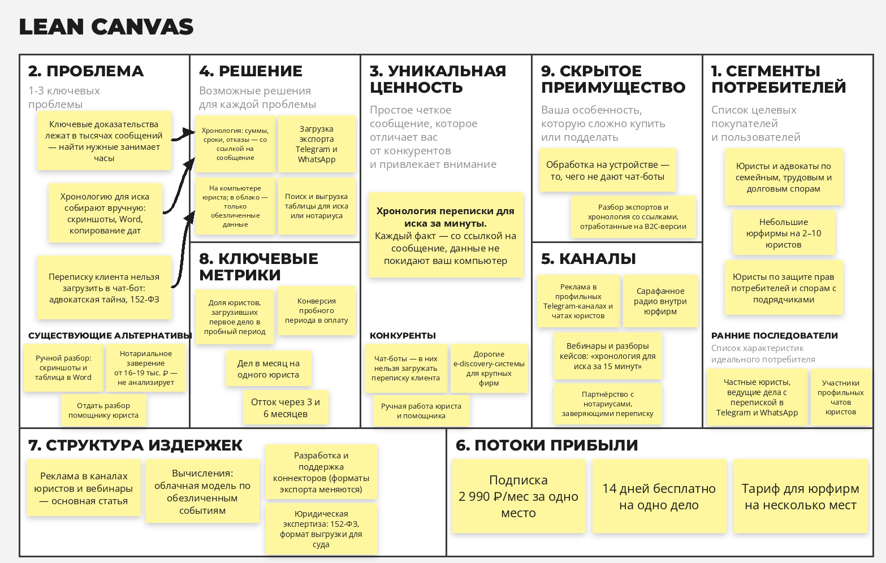

# Memolith

**Биография, собранная из вашего цифрового следа.**

Проект по курсу «Методы управления разработкой ПО»
VK Education × МГТУ им. Н. Э. Баумана

**Автор:** Синявский С. Д., web-13 (Telegram: @winlast)
**Бизнес-модель:** B2C

---

## Задание №1

### Elevator Pitch

Попробуйте вспомнить, что происходило в вашей жизни в марте 2021 года. Скорее всего, не получится — хотя этот месяц записан подробнее, чем жизнь любого поколения до вас: тысячи фото с датами и координатами, годы переписок, голосовые, заметки. И этот архив тихо исчезает: аккаунт удалён, телефон потерян, чат почищен.

**Memolith** собирает ваши цифровые следы в один архив и превращает их в биографию. Вы выгружаете переписки, медиа и записи — сервис строит хронологию: где вы жили, с кем общались, что происходило в каждый период, — и пишет по ней связный текст, который можно читать, искать по нему и дополнять.

В отличие от сервисов памяти вроде Biograph и Memora, которые просят записывать моменты вручную, мы поднимаем то, что уже записано. Сырые переписки при этом не покидают ваше устройство.

В результате десять лет вашей жизни перестают быть папкой на 100 гигабайт и становятся историей, которую можно прочитать и передать дальше.

Выгрузите один чат — и посмотрите, что Memolith расскажет про ваш прошлый год.

---

### Lean Canvas

---

## Задание №2

### Продуктовые риски (по Марти Кагану)

**Риск ценности (Value risk) — самый критичный.** Выберут ли нас вместо подписки на ChatGPT или Claude (дальше — чат-боты), которая у многих уже есть? Пересказать один чат чат-бот может уже сегодня, поэтому ценность Memolith держится только на том, чего он не делает:

- десять лет переписок не помещаются в окно контекста, и чат-бот читает их выборочно;
- даты и координаты тысяч фото он не разбирает и не связывает с перепиской;
- после закрытия диалога не остаётся хронологии, которую можно дополнять;
- сырые переписки приходится отдавать чужой компании.

Второй слой риска — результат разовый: человек получает историю, скачивает PDF и уходит. Поэтому месячная подписка под вопросом, и платить, скорее всего, будут разово. Для этого риска ниже расписана HADI-гипотеза.

**Риск жизнеспособности (Viability risk).** Архив одного человека — десятки гигабайт медиа, а платит он в основном один раз. Поэтому медиа по умолчанию не храним, только метаданные и события хронологии. Привлекать аудиторию 35–60 через рекламу дорого, и экономика держится на органических каналах (расчёт ниже). Юридический риск: в переписках есть персональные данные собеседников (152-ФЗ). Поэтому сырые переписки обрабатываются только на устройстве, серверы находятся в РФ, а имена третьих лиц в печатных книгах заменяются инициалами.

**Риск осуществимости (Feasibility risk).**

- **Форматы экспорта.** Мессенджеры меняют их без предупреждения, поэтому начинаем с одного источника: Telegram + фото.
- **Фото и видео.** Распознавать каждое дорого и не нужно. Хронология строится по метаданным (дата и координаты из EXIF), модель смотрит только 3–5 фото на событие.
- **Приватность.** Полностью оставить всё на устройстве не получится: хороший текст пишет облачная модель. Поэтому ей уходят только события, где имена заменены метками («переезд в Москву, помогал [П3]»). Для мощных компьютеров есть локальный режим.
- **Выдуманные факты.** Чтобы модель их не придумывала, у каждого факта в тексте есть ссылка на источник (подход RAG).

**Риск юзабилити (Usability risk).** Ручная выгрузка — самое слабое место: сегмент 35–60 может не дойти до первого импорта. Решение — пошаговые инструкции с картинками, старт с одного чата и первый результат через 10 минут после загрузки.

### HADI-гипотеза для риска ценности

**H (Гипотеза):** Мы верим, что люди, которые уже платят за чат-бота, выберут Memolith и заплатят за него: история из всех переписок и фото с датами и местами даёт то, чего чат-бот не даёт.

**A (Действие):** Консьерж-MVP. Через лендинг и рекламу на 15 000 ₽ находим 20 человек с платной подпиской на чат-бота. Каждый сам делает в нём историю своего года по нашему промпту. Мы вручную собираем историю того же года из всех его чатов Telegram и фото. Показываем оба результата и предлагаем предоплату: электронная история — 1 490 ₽, печатная книга — 3 490 ₽, годовой тариф «Архив» — 1 990 ₽.

**D (Данные):** какой результат предпочли и почему; оценка нашего текста от 1 до 10 («узнали ли вы себя»); доля внёсших предоплату и что они выбрали; доля сумевших выгрузить чаты (риск юзабилити); стоимость заявки.

**I (Выводы):**

- 14 и более из 20 предпочитают наш результат и 6 и более вносят предоплату — гипотеза подтверждена, переходим к MVP;
- большинству хватает чат-бота или предоплату вносят 2 и менее — продукт не защищён от универсальных нейросетей, переходим к Pivot;
- между этими значениями — усиливаем то, за что выбрали нас, и повторяем эксперимент.

---

### Юнит-экономика

За юнит принимаем 1 платящего пользователя.

**Модель монетизации.** Месячную подписку из Lean Canvas не считаем: результат разовый (см. риск ценности). Считаем freemium с разовыми покупками. Ориентир по ценам — Zapptales, который печатает книги из чатов: PDF ≈ €17, твёрдая обложка ≈ €36.

- бесплатно — первая глава истории одного года и карточка «мой год в переписках» для соцсетей;
- полная история периода — 1 490 ₽;
- печатная книга — 3 490 ₽;
- годовой тариф «Архив» (копия медиа, новая глава раз в год) — 1 990 ₽/год.

**CAC.** Реклама на аудиторию 35–60 дорогая, поэтому основной трафик дают органические каналы из Lean Canvas. Воронка за месяц:

- реклама VK / Telegram Ads: 20 000 ₽ → 800 кликов по 25 ₽ → 96 регистраций → 38 доходят до первого импорта;
- SEO-инструкции «как выгрузить переписку из Telegram»: 20 000 ₽ → 5 000 визитов → 300 регистраций → 150 импортов;
- вирусность (карточка «мой год», книга в подарок): 0,3 нового пользователя на каждого → ещё 56;
- бесплатная первая глава: 244 × 5 ₽ ≈ 1 220 ₽.

Итого ≈ 41 220 ₽ и 244 активированных пользователя. В покупку конвертируется 10% (ориентир — медиана RevenueCat для жёсткого пейволла ≈ 10,7%) → 24 платящих. **CAC ≈ 1 690 ₽.** Только на платной рекламе было бы 25 / 0,12 / 0,4 / 0,1 ≈ 5 200 ₽.

**LTV:**

- первая покупка: 60% берут электронную историю (маржа ≈ 1 400 ₽), 40% — книгу (3 490 ₽ − печать и доставка ≈ 1 650 ₽ − эквайринг и генерация ≈ 150 ₽ ≈ 1 690 ₽) → в среднем ≈ 1 520 ₽;
- экземпляр книги в подарок: 15% × маржа ≈ 765 ₽ → ≈ 115 ₽;
- история следующего года: 25% × 1 520 ₽ → ≈ 380 ₽;
- «Архив»: 10% платящих. Хранение ≈ 40 ГБ × ~2 ₽ в месяц (Yandex Object Storage) съедает больше половины цены, в среднем 1,5 года → ≈ 110 ₽;
- **LTV ≈ 2 120 ₽**.

| Показатель | Значение |
|---|---:|
| CAC (органика + реклама) | ≈ 1 690 ₽ |
| LTV | ≈ 2 120 ₽ |
| LTV / CAC | ≈ 1,25 |
| LTV / CAC только на платной рекламе | ≈ 0,4 |

**Вывод:** экономика сходится в небольшой плюс: каждый клиент окупает привлечение и приносит сверху около четверти. Но до «золотого стандарта» 3 : 1 далеко. Кроме того, всё держится на двух допущениях, которые проверяем в MVP: ≈ 5 000 визитов в месяц с SEO и 0,3 приглашённых на пользователя. Расти через платную рекламу нельзя, поэтому Pivot проектируем как резервный план.

---

### Pivot (План Б)

**Тип Pivot:** Customer Segment Pivot + Customer Need Pivot (B2C → B2B). Включаем, если органика в MVP не подтвердится и CAC приблизится к рекламному.

Хронология из переписки нужна не только для воспоминаний. В разводах, трудовых спорах и взыскании долгов главное доказательство часто лежит в мессенджере. Юрист вручную листает тысячи сообщений, чтобы собрать хронологию для иска. Ценность такой переписки видна по цене: нотариальное заверение одного чата стоит от 16–19 тыс. ₽.

Этот сегмент решает проблемы B2C-модели. У юриста постоянный поток дел, поэтому подписка оправдана. Загрузить переписку клиента в чат-бот он не может (адвокатская тайна, 152-ФЗ). Хранить медиа не нужно. Только адвокатов в России около 75,8 тыс. (ФПА, 2025).

**Переиспользуем:** разбор экспортов, хронологию, ссылки на источник каждого факта, обработку на устройстве.

**Убираем:** текст биографии, книгу, хранение медиа.

**Добавляем:** выделение юридически значимых событий (суммы, сроки, договорённости, отказы) и выгрузку хронологии для иска или нотариуса.

### Elevator Pitch для Pivot

В разводе, трудовом споре или взыскании долга главное доказательство часто лежит в мессенджере — в переписке на несколько тысяч сообщений. Юрист листает её вечерами и вручную собирает хронологию для иска.

**Memolith для юристов** делает это за минуты. Сервис строит по экспорту чата хронологию ключевых событий — договорённости, суммы, сроки, отказы — и к каждому пункту даёт ссылку на точное сообщение. Переписка обрабатывается на компьютере юриста и никуда не уходит, поэтому адвокатская тайна не нарушается.

Подписка — 2 990 ₽ в месяц, первые 14 дней бесплатно: загрузите переписку по текущему делу и посмотрите, сколько часов это сэкономит.

### Lean Canvas для Pivot

### Юнит-экономика Pivot

За юнит принимаем 1 юриста (одно место в подписке).

**CAC:** реклама в профильных Telegram-каналах (60 000 ₽) и вебинары (15 000 ₽) → 1 500 переходов → 150 регистраций на пробный период → 68 загружают первое дело → 12 оплачивают. CAC = 75 000 / 12,2 ≈ **6 150 ₽**.

**LTV:** подписка 2 990 ₽/мес минус эквайринг, вычисления и поддержка ≈ 590 ₽ → маржа ≈ 2 400 ₽ в месяц. Срок жизни берём осторожно — 10 месяцев → **LTV ≈ 24 000 ₽**.

| Показатель | Значение |
|---|---:|
| CAC | ≈ 6 150 ₽ |
| LTV | ≈ 24 000 ₽ |
| LTV / CAC | ≈ 3,9 |

**Вывод:** LTV / CAC ≈ 3,9 — в диапазоне от 3 до 5, экономика сходится с запасом на рост. Главный риск после Pivot — риск ценности: наша хронология сама по себе не доказательство, а юристы консервативны. Первым шагом проверяем его консьерж-MVP на 15 юристах с реальными делами.

---

## Задание №3

Задание выполнено для исходной B2C-модели Memolith: по расчёту в Задании №2 она окупается, а Pivot остаётся резервным планом. Ядро продукта — загрузка экспорта (история 3) и хронология со ссылками на источники (истории 6–8) — без изменений переходит и в Pivot для юристов.

### Роли

- **Р1. Владелец архива** — человек 35–60 лет с цифровым следом за 10–20 лет; основной пользователь, платит за историю периода.
- **Р2. Ранний пользователь** — 18–30 лет, технически подкованный, сам разбирается с выгрузками и хочет подключить как можно больше источников.
- **Р3. Человек на важном этапе жизни** — выпуск, переезд, рождение ребёнка; хочет подвести итог периода и получить артефакт.
- **Р4. Член семьи** — собирает историю вместе с родственниками (семейный тариф).

### User Stories

1. Р1: Как владелец архива, я хочу зарегистрироваться по e-mail или через VK ID, чтобы начать без долгой настройки.
2. Р1: Как владелец архива, я хочу получить пошаговую инструкцию с картинками, как выгрузить чат из Telegram, чтобы справиться с экспортом без посторонней помощи.
3. Р1: Как владелец архива, я хочу загрузить экспорт переписки Telegram, чтобы сервис построил по нему хронологию.
4. Р1: Как владелец архива, я хочу загрузить папку с фотографиями, чтобы даты и места из EXIF попали в хронологию.
5. Р1: Как владелец архива, я хочу, чтобы сырые переписки обрабатывались на моём устройстве, а в облако уходили только обезличенные события, чтобы не бояться утечки личных сообщений.
6. Р1: Как владелец архива, я хочу видеть хронологию по периодам — где я жил, с кем общался, что происходило, — чтобы восстановить, что было в конкретный год.
7. Р1: Как владелец архива, я хочу получить связный текст биографии за выбранный период, чтобы читать историю, а не листать тысячи сообщений.
8. Р1: Как владелец архива, я хочу видеть, из каких сообщений и фото взят каждый факт в тексте, чтобы убедиться, что сервис ничего не выдумал.
9. Р1: Как владелец архива, я хочу исправить или удалить неверный факт и перегенерировать главу, чтобы биография была правдивой.
10. Р1: Как владелец архива, я хочу искать по архиву и задавать вопросы («когда я переехал в Москву?»), чтобы быстро находить нужное.
11. Р1: Как владелец архива, я хочу дописать воспоминание, которого нет в цифровом следе, чтобы история была полной.
12. Р1: Как владелец архива, я хочу удалить весь архив и все производные данные одной кнопкой, чтобы контролировать свои данные.
13. Р1: Как владелец архива, я хочу бесплатно прочитать первую главу и, если понравится, один раз оплатить полную историю периода, чтобы скачать её и хранить у себя.
14. Р3: Как человек на важном этапе жизни, я хочу заказать печатную книгу выбранного периода, чтобы подарить её или оставить на память.
15. Р3: Как человек на важном этапе жизни, я хочу получить видео-подборку периода из своих фото, чтобы поделиться ею с близкими.
16. Р2: Как ранний пользователь, я хочу подключить другие источники — WhatsApp, VK, Google Takeout, заметки, голосовые, — чтобы биография была полнее.
17. Р2: Как ранний пользователь, я хочу экспортировать биографию в PDF или Markdown, чтобы хранить её у себя независимо от сервиса.
18. Р4: Как член семьи, я хочу объединить свой архив с архивом родственника, чтобы видеть общие события на одной ленте.
19. Р1: Как владелец архива, я хочу поделиться в соцсетях карточкой «мой год в переписках» — статистикой без текста сообщений, — чтобы показать друзьям, что нашёл сервис.
20. Р1: Как владелец архива, я хочу по желанию оформить годовой тариф «Архив», чтобы сервис хранил зашифрованную копию моих медиа и раз в год дописывал новую главу.

### Приоритизация (MoSCoW)

**M — Must have (обязаны):**

- регистрация (история 1);
- инструкция по выгрузке Telegram (история 2);
- загрузка экспорта Telegram (история 3);
- загрузка фото с EXIF (история 4);
- локальная обработка сырых переписок (история 5);
- хронология по периодам (история 6);
- текст биографии за период (история 7);
- источник каждого факта (история 8);
- удаление архива одной кнопкой (история 12);
- бесплатная первая глава и разовая оплата полной истории (история 13).

**S — Should have (должны):**

- исправление фактов и перегенерация главы (история 9);
- поиск и вопросы к архиву (история 10);
- печатная книга периода (история 14);
- другие источники: WhatsApp, VK, Google Takeout (история 16);
- экспорт в PDF / Markdown (история 17);
- карточка «мой год в переписках» — главный вирусный канал из расчёта CAC (история 19);
- годовой тариф «Архив» (история 20).

**C — Could have (могли бы):**

- ручные воспоминания (история 11);
- видео-подборка периода (история 15).

**W — Won't have (не будет в этой версии):**

- семейный тариф и общий архив (история 18) — это второй сегмент, к нему переходим после проверки основного;
- автоматическая синхронизация через API мессенджеров вместо ручной выгрузки — риск блокировки аккаунта и сложная юридическая часть;
- мобильное приложение — для разбора экспорта на старте достаточно десктопа;
- распознавание содержимого всех фото и видео — хронология строится по метаданным, модель смотрит только несколько фото на событие.

### MVP и MLP

**MVP.** Проверяем ценность: узнаёт ли человек себя в истории, собранной из одного чата и папки фото, и готов ли за неё платить. Источник один — экспорт Telegram плюс фото. Пользователь регистрируется, по инструкции выгружает чат, загружает его вместе с фото и на своём устройстве получает хронологию. Затем бесплатно читает первую главу истории за выбранный год со ссылками на источники фактов. Может оплатить полную историю и скачать её или удалить всё одной кнопкой.

В MVP входят истории Must have: 1–8, 12, 13.

**MLP.** Добавляет то, ради чего к сервису хочется возвращаться и о чём хочется рассказать:

- исправление фактов и перегенерация глав — биография становится «своей» (история 9);
- поиск и вопросы к архиву — сервис превращается в личную память, а не в разовый текст (история 10);
- печатная книга периода — главный «вау»-артефакт, самая маржинальная покупка и подарок, который приводит новых пользователей (история 14);
- карточка «мой год в переписках» для соцсетей — бесплатный канал привлечения (история 19);
- новые источники и экспорт в PDF / Markdown (истории 16, 17);
- годовой тариф «Архив» — единственный повод платить регулярно: копия медиа хранится, а история дописывается раз в год (история 20);
- опционально из Could have: ручные воспоминания и видео-подборка (истории 11, 15).

| MVP | MLP |
|---|---|
| Один источник: Telegram + фото | WhatsApp, VK, Google Takeout, заметки |
| Хронология и текст за период | Исправление фактов и перегенерация глав |
| Ссылки на источники фактов | Поиск и вопросы к архиву |
| Бесплатная первая глава и разовая оплата истории | Печатная книга, видео-подборка, годовой тариф «Архив» |
| Удаление архива | Карточка «мой год», экспорт в PDF / Markdown, ручные воспоминания |

### Детализация требований для MVP

**История 3 — загрузка экспорта Telegram**

*Как владелец архива, я хочу загрузить экспорт переписки Telegram, чтобы сервис построил по нему хронологию.*

Функциональные требования:

1. Я могу загрузить экспорт Telegram Desktop в формате JSON или HTML, а также ZIP-архив с ним, объёмом до 2 ГБ.
2. Я могу до начала анализа исключить отдельные чаты из обработки.
3. Система разбирает каждое сообщение: дату, автора, текст, тип вложения, ответы и пересылки; служебные сообщения отбрасывает.
4. Система показывает прогресс обработки, а по её окончании — итог: сколько чатов и сообщений обработано и за какой период.
5. Если формат не распознан или экспорт неполный, система выводит понятное сообщение и ссылку на инструкцию по выгрузке (история 2).
6. Повторная загрузка того же чата не создаёт дубликатов — добавляются только новые сообщения.

Нефункциональные требования:

1. **Приватность.** Сырые сообщения обрабатываются только на устройстве пользователя; на сервер передаются только события хронологии, в которых имена людей и точные адреса заменены метками. Это проверяется анализом сетевого трафика клиента.
2. **Производительность.** Экспорт на 100 000 сообщений обрабатывается не дольше 10 минут на ноутбуке с 8 ГБ RAM; прерванная обработка продолжается с места остановки.
3. **Надёжность.** Ошибка разбора одного сообщения не останавливает обработку всего файла; доля нераспознанных сообщений — не больше 1%.
4. **Безопасность.** Производные данные передаются только по HTTPS (TLS 1.2+), хранятся в зашифрованном виде на серверах в РФ (152-ФЗ).
5. **Совместимость.** Клиент работает на Windows 10+ и macOS 12+, веб-версия — в последних версиях Chrome, Firefox, Edge и Яндекс Браузера.

**История 7 — текст биографии за период**

*Как владелец архива, я хочу получить связный текст биографии за выбранный период, чтобы читать историю, а не листать тысячи сообщений.*

Функциональные требования:

1. Я могу выбрать период (месяц, год или свой диапазон) и получить текст биографии, разбитый на главы по подпериодам.
2. Система строит текст только по событиям хронологии; у каждого факта в тексте есть ссылка на исходные сообщения и фото (история 8).
3. Если за период мало данных (меньше 50 событий), система предупреждает об этом и предлагает добавить источники вместо генерации «пустого» текста.
4. Я могу выбрать повествование от первого или от третьего лица и перегенерировать отдельную главу.
5. Первая глава доступна бесплатно; остальные главы открываются после разовой оплаты (история 13).
6. Готовый текст сохраняется в архиве и доступен для повторного чтения.

Нефункциональные требования:

1. **Производительность.** Текст за один год генерируется не дольше 60 секунд; во время генерации пользователь видит прогресс.
2. **Достоверность.** На тестовом наборе из 20 размеченных архивов доля фактов без подтверждающего источника — не больше 2%.
3. **Стоимость.** Себестоимость генерации текста за год вместе с перегенерацией глав — не больше 50 ₽, иначе не сходится маржа разовой покупки за 1 490 ₽. Бесплатная первая глава — не больше 5 ₽.
4. **Приватность.** Облачной языковой модели передаются только обезличенные события хронологии: имена и адреса заменяются метками на устройстве и подставляются обратно в готовый текст тоже на устройстве. Провайдер модели по договору не использует данные для обучения. Для мощных компьютеров доступен полностью локальный режим генерации.
5. **Удобство чтения.** Текст корректно отображается на экранах от 360 px, ширина строки и шрифт рассчитаны на долгое чтение.
