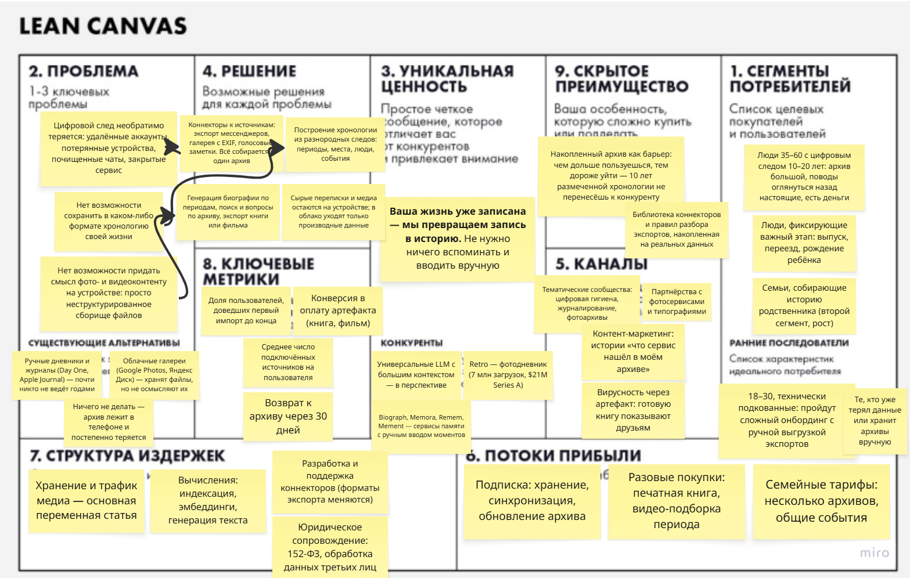

# Memolith

**Биография, собранная из вашего цифрового следа.**

Проект по курсу «Методы управления разработкой ПО»
VK Education × МГТУ им. Н. Э. Баумана

**Автор:** Синявский С. Д., web-XX
**Бизнес-модель:** B2C

---

## Задание №1

### Elevator Pitch

Попробуйте вспомнить, что происходило в вашей жизни в марте 2021 года. Скорее всего, не получится — хотя этот месяц записан подробнее, чем жизнь любого поколения до вас: тысячи фото с датами и координатами, годы переписок, голосовые, заметки. И этот архив тихо исчезает: аккаунт удалён, телефон потерян, чат почищен.

**Memolith** собирает ваши цифровые следы в один архив и превращает их в биографию. Вы выгружаете переписки, медиа и записи — сервис строит хронологию: где вы жили, с кем общались, что происходило в каждый период, — и пишет по ней связный текст, который можно читать, искать по нему и дополнять.

В отличие от сервисов памяти вроде Biograph и Memora, которые просят записывать моменты вручную, мы поднимаем то, что уже записано. Сырые переписки при этом не покидают ваше устройство.

В результате десять лет вашей жизни перестают быть папкой на 100 гигабайт и становятся историей, которую можно прочитать и передать дальше.

Выгрузите один чат — и посмотрите, что Memolith расскажет про ваш прошлый год.

---

### Lean Canvas

